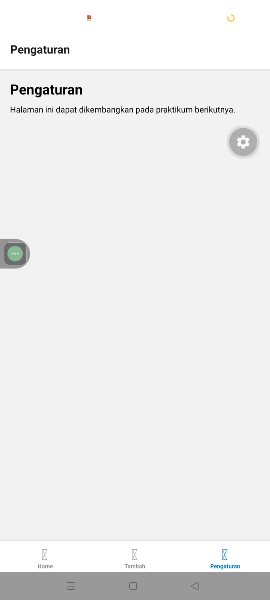
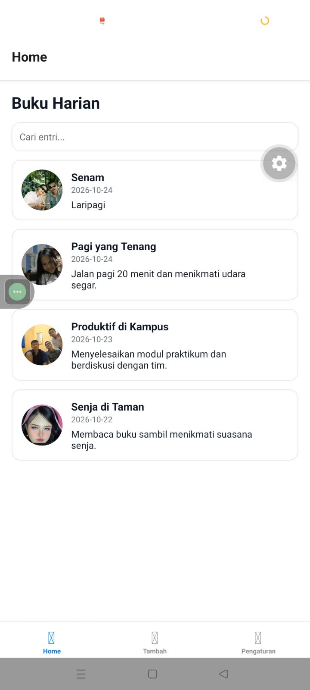
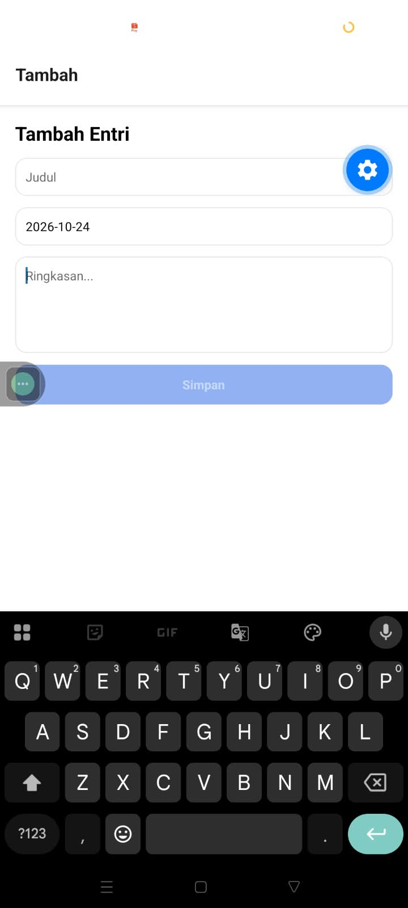
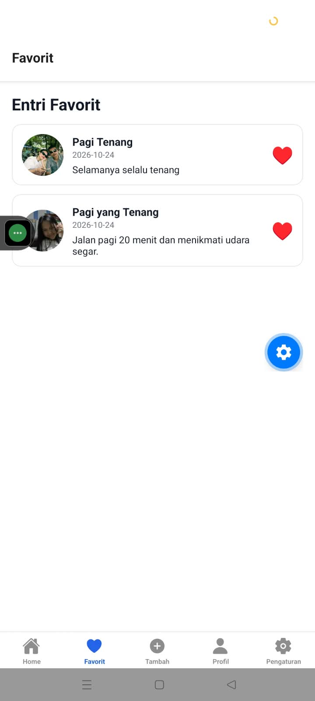
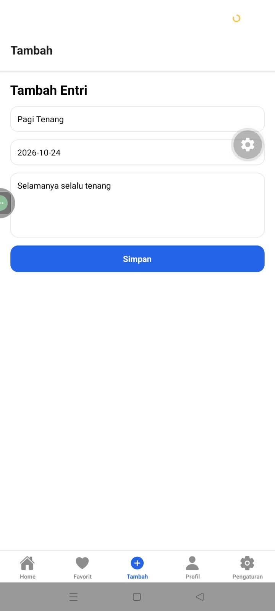

# Diary App - Tugas Praktikum 	Mobile Multi PLatform

## Identitas
- **Nama:** Firmansah Rahadi
- **NIM:** 2430511033
- **Mata Kuliah:** 	Mobile Multi PLatform

## Cara Menjalankan Project
1. Pastikan Node.js sudah terinstal di komputer.
2. Buka terminal/Command Prompt dan arahkan ke folder direktori project ini.
3. Jalankan perintah `npm install` untuk menginstal semua *dependency* (jika folder `node_modules` tidak ada).
4. Jalankan perintah `npx expo start -c` untuk menjalankan *development server* dengan *cache* yang bersih.
5. Buka aplikasi menggunakan aplikasi **Expo Go** di *smartphone* fisik atau menggunakan **Android Emulator**.

## Struktur Route
Aplikasi ini menggunakan Expo Router berbasis file dengan struktur sebagai berikut:
- `app/_layout.tsx`: Root layout yang membungkus aplikasi dengan Context Provider dan Root Stack.
- `app/(tabs)/_layout.tsx`: Layout untuk Bottom Tab Navigation.
- `app/(tabs)/index.tsx`: Route halaman utama (Home) yang menampilkan daftar entri buku harian.
- `app/(tabs)/favorites.tsx`: Route halaman untuk menampilkan entri yang disukai.
- `app/(tabs)/create.tsx`: Route halaman untuk menambah entri baru.
- `app/(tabs)/profile.tsx`: Route halaman profil/about mahasiswa.
- `app/(tabs)/settings.tsx`: Route halaman pengaturan aplikasi.
- `app/detail/[id].tsx`: Dynamic route untuk menampilkan detail entri berdasarkan ID.

## Penjelasan Navigasi
1. **Stack Navigation:** 
   Digunakan pada Root level (`app/_layout.tsx`) untuk menumpuk halaman Detail di atas halaman Tabs. Ini memungkinkan pengguna melihat detail entri dengan mode layar penuh dan memiliki tombol navigasi "Back" (kembali) bawaan di header untuk kembali ke halaman sebelumnya.
   
2. **Tabs Navigation:** 
   Digunakan di dalam grup route `(tabs)` untuk menyediakan menu navigasi bawah (*Bottom Tabs*). Memudahkan pengguna untuk berpindah dengan cepat antar fitur utama seperti Home, Favorit, Tambah, Profil, dan Pengaturan tanpa kehilangan *state* halaman.
   
3. **Dynamic Route:** 
   Digunakan pada file `app/detail/[id].tsx`. Tanda kurung siku `[id]` menandakan bahwa route ini bersifat dinamis dan dapat menerima parameter berupa ID. Parameter ini kemudian dibaca menggunakan hook `useLocalSearchParams()` untuk menampilkan data detail buku harian yang spesifik sesuai dengan entri yang diklik oleh pengguna.

   ## Screenshot Aplikasi

### Sebelum Tugas Tambahan

  
  
  

### Sesudah Tugas Tambahan (Hasil Akhir)

  
  
  
  

